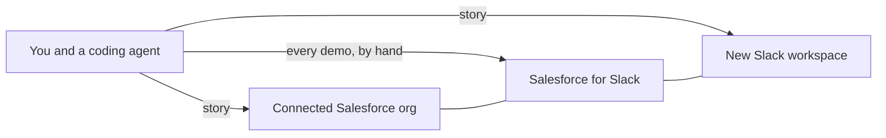

# Demo builder for Slack and Salesforce

Give a coding agent an industry, a use case, and the story. The agent seeds the Salesforce org it is signed into, and creates a new Slack workspace for that story. You connect that workspace to Salesforce yourself, with Salesforce's native Slack connector.

You talk to whichever coding agent you use. The Slack app in [`slack/manifest.json`](slack/manifest.json) only creates the workspace. The procedure that agent follows is [`AGENT.md`](AGENT.md).



Install the workspace app once, on a Slack Enterprise Grid org, and grant it to workspaces created later. Each demo is a new workspace. Salesforce records show up in that workspace only after you connect Salesforce for Slack to it. There is no flow in this project that posts to Slack.

A Salesforce demo org is the usual place to seed. The agent uses the org it is signed into. This project does not keep a list of which orgs are allowed.

## Manual setup

The first three steps are once per org. The last step is every demo, because each demo is a new workspace.

### 1. Install the workspace app on the org

Create a Slack app from [`slack/manifest.json`](slack/manifest.json): Slack API, Create New App, From a manifest. Install it on the Enterprise Grid org, not on one workspace. Grant it to future workspaces. Approve it if the org requires an admin.

The app has no slash command and no conversation. The org-admin token from this install is what creates each new workspace. This app is not Salesforce for Slack.

### 2. Store the org-admin token

Keep that user token in the coding agent's secret store. The agent uses it for `admin.teams.create`. Do not put it in a Salesforce named credential, and do not commit it.

### 3. Connect Salesforce for seeding

Sign the coding agent into the Salesforce org that should receive the records. Use the Salesforce connector, or a hosted MCP server whose external client app you create in Setup. This login lets the agent create records. It does not connect Slack.

### 4. Connect each new workspace with Salesforce for Slack

Do this yourself, every demo, after the agent has created the workspace.

Add the Salesforce for Slack app to that workspace and connect it to the Salesforce org you seeded. In Salesforce, finish Initial Slack Setup the first time this org is allowed to connect to Slack. Pick the new workspace when Slack asks which one you are connecting.

That native connector is how the seeded records show up in Slack. This project does not deploy a flow, a named credential, or a call to `chat.postMessage` to do that job.

## Give this to your coding agent

Point any coding agent at [`AGENT.md`](AGENT.md). You choose the industry, the company, the use case, and the story.

```text
Follow AGENT.md in this repository.

Industry: <the industry for this demo>
Company: <the company in the story>
Use case: <one sentence>
Story:
- <what exists at the start>
- <what happens next>
- <how it ends>
```

The agent replies with the manual steps that are still open, creates a Slack workspace named after the company, and seeds the Salesforce records. It then stops and asks you to connect Salesforce for Slack to that workspace. You do not message the app.

[demos/education-advising.json](demos/education-advising.json) and [demos/healthcare-prior-auth.json](demos/healthcare-prior-auth.json) are two filled-in examples. They are fictional, and they are not the only industries this builds. Record ids and Slack ids, when an agent creates them, go in `demos/<id>.links.json`, which is gitignored.

Check the planner:

```bash
node scripts/plan.test.mjs
```

## What the agent will leave to you

- Installing the workspace app on the Enterprise Grid org and granting it to future workspaces.
- Storing the org-admin token.
- Connecting Salesforce for Slack to each new workspace. This one is every demo.
- Creating a new object, field, or Apex class, if the story needs one. The default path uses Account, Case, and Opportunity.

## License

[MIT](LICENSE)
