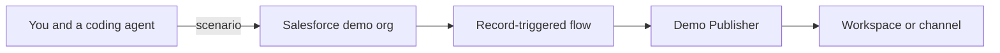

# Demo builder for Slack and Salesforce

Give a coding agent an industry, a use case, and the flow. The agent seeds a Salesforce demo org and wires it so record changes show up in Slack on their own.

You talk to the coding agent. The Slack app only publishes messages. Its manifest is [`slack/manifest.json`](slack/manifest.json). The procedure the agent follows is [`.cursor/skills/demo-builder/SKILL.md`](.cursor/skills/demo-builder/SKILL.md).



One install of Demo Publisher serves every demo. On Enterprise Grid the agent creates a workspace per industry, then a channel inside it. On a single Slack workspace the agent creates a channel per demo. Both use the same manifest.

## Manual setup

Do these once. On the next demo the agent repeats only the steps that are still open.

### 1. Install the Slack app

Create a Slack app from [`slack/manifest.json`](slack/manifest.json): Slack API, Create New App, From a manifest.

On Enterprise Grid, install it on the org, not on a single workspace, and approve it if your org requires an admin. That install can create workspaces. Set `slack.enterpriseGrid` to `true` in the local config after it succeeds.

On one workspace, remove the `oauth_config.scopes.user` block from the manifest before you install. A workspace install cannot create other workspaces. Leave `slack.enterpriseGrid` false. Each demo gets a channel instead.

The app has no slash command and no conversation. It posts as Demo Publisher.

### 2. Store the bot token in Salesforce

From the install, create a named credential in the demo org for `https://slack.com/api` using the bot token as a bearer token. On Grid, keep the org-admin user token in the coding agent's secret store as well. The agent needs it for `admin.teams.create`.

Do not commit either token.

### 3. Connect a Salesforce demo org

Use a demo org, a sandbox, or a developer org where the agent can create accounts and cases. Keep production orgs out of this workflow.

Sign the agent in with the Salesforce connector, or with a hosted MCP server whose external client app you create in Setup.

### 4. Mark the orgs

```bash
cp demos/org.example.json demos/org.local.json
```

Set `demoOrgLabel` to the demo org's company name, the same name Salesforce shows on the company profile. Add every production org to `productionOrgLabels`. Set `slack.orgName` to your Slack org. Set `slack.enterpriseGrid` to `true` only after the org-level install.

`demos/org.local.json` is gitignored.

### 5. Let the agent deploy the publisher flow

The flow is an after-save flow on Case. When a case tagged `demo-builder:<id>` is created or its status changes, the flow POSTs [`salesforce/slack-post.json`](salesforce/slack-post.json) to Slack. The named credential supplies the token.

If the agent's Salesforce login can create records but cannot deploy metadata, deploy this flow once with the Salesforce CLI. Later demos reuse it and only change the channel and the tag.

### 6. Check a trial date

If the demo org expires, set `trialExpires` to `YYYY-MM-DD`. Leave it empty when the org does not expire.

## Give this to your coding agent

Open this repository in Cursor. The project skill loads from [`.cursor/skills/demo-builder/SKILL.md`](.cursor/skills/demo-builder/SKILL.md).

```text
Follow .cursor/skills/demo-builder/SKILL.md
Industry: Education
Company: Northbridge Academy
Use case: An advisor picks up a student case when Maya Chen has waited two days for a course change.
Flow:
- Northbridge Academy is the school account, and Maya Chen is the student.
- A case opens for a course change, waiting on the advisor.
- The case sits past two days.
- The case moves to closed when the advisor approves the change.
```

The agent replies with the manual steps that are still open, then creates the Slack channel or workspace, the Salesforce records, and the flow. Changing the case status is what makes Demo Publisher post. You do not message the app.

[demos/education-advising.json](demos/education-advising.json) is that brief, planned for a single workspace. Harbor & Pine Health in [demos/healthcare-prior-auth.json](demos/healthcare-prior-auth.json) is a second fictional story. Record ids, when an agent creates them, go in `demos/<id>.links.json`, which is gitignored.

Check the planner:

```bash
node scripts/plan.test.mjs
```

## What the agent will leave to you

- Installing and approving the Slack app.
- Putting tokens into the named credential and the agent secret store.
- Deploying the flow when the Salesforce login cannot deploy metadata.
- Creating a new object, field, or Apex class, if the story needs one. The default path uses Account, Case, and Opportunity.
- Renewing a trial org.

## LinkedIn

Paste this, and add the repository link:

> I built a demo builder for Slack and Salesforce. You give a coding agent an industry, a use case, and the flow. It seeds the Salesforce demo and a Slack app publishes the changes into a channel, or into a new workspace on Enterprise Grid. The manual install steps are in the README. The skill is in the repo, so another agent can run the same build.

## License

[MIT](LICENSE)
