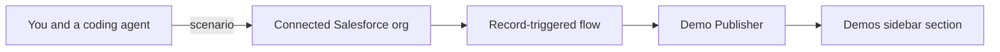

# Demo builder for Slack and Salesforce

Give a coding agent an industry, a use case, and the flow. The agent seeds the Salesforce org it is signed into, and wires that org so record changes show up in Slack on their own.

You talk to the coding agent. The Slack app only publishes messages. Its manifest is [`slack/manifest.json`](slack/manifest.json). The procedure the agent follows is [`.cursor/skills/demo-builder/SKILL.md`](.cursor/skills/demo-builder/SKILL.md).



Install Demo Publisher once, in one Slack workspace. Each demo is a channel in that workspace. The channels sit together in a sidebar section named Demos. The section is the `@demos` user group, with "show as a sidebar section" turned on. Members of `@demos` see the section. Slack does not offer a public API for a private sidebar section, so this is the supported way to share one.

A Salesforce demo org is the usual place to seed. The agent uses the org it is signed into. This project does not keep a list of which orgs are allowed.

## Manual setup

Do these once. On the next demo the agent repeats only the steps that are still open.

### 1. Install the Slack app

Create a Slack app from [`slack/manifest.json`](slack/manifest.json): Slack API, Create New App, From a manifest. Install it in the workspace where the demos should appear. Approve it if that workspace requires an admin.

The app has no slash command and no conversation. It posts as Demo Publisher, creates the demo channels, and maintains the Demos section.

### 2. Store the bot token in Salesforce

From the install, create a named credential in the Salesforce org for `https://slack.com/api`, using the bot token as a bearer token. Do not commit the token.

### 3. Allow the Demos section

Shared sidebar sections need a paid Slack plan. In workspace permissions, allow user groups to be created and edited. The agent creates `@demos` and turns the group into a sidebar section. Join `@demos` so the section shows in your sidebar.

### 4. Connect Salesforce

Sign the coding agent into the Salesforce org that should receive the records and the flow. Use the Salesforce connector, or a hosted MCP server whose external client app you create in Setup.

### 5. Let the agent deploy the publisher flow

The flow is an after-save flow on Case. When a case tagged `demo-builder:<id>` is created or its status changes, the flow POSTs [`salesforce/slack-post.json`](salesforce/slack-post.json) to Slack. The named credential supplies the token.

If the agent's Salesforce login can create records but cannot deploy metadata, deploy this flow once with the Salesforce CLI. Later demos reuse it and only change the channel and the tag.

The section label defaults to Demos. To change it, copy [`demos/org.example.json`](demos/org.example.json) to `demos/org.local.json` and edit `sectionName` and `sectionHandle`. That local file is gitignored.

## Give this to your coding agent

Open this repository in Cursor. The project skill loads from [`.cursor/skills/demo-builder/SKILL.md`](.cursor/skills/demo-builder/SKILL.md).

```text
Follow .cursor/skills/demo-builder/SKILL.md
Industry: Education
Company: Northbridge Academy
Use case: An advisor picks up a student case when Maya Chen has waited two days for a course change.
Flow:
- Northbridge Academy is the school account, and Maya Chen is the student.
- A case opens for a course change, waiting on the advisor.
- The case sits past two days.
- The case moves to closed when the advisor approves the change.
```

The agent replies with the manual steps that are still open, then creates `#education-advising`, adds it to the Demos section, seeds the Salesforce records, and attaches the flow. Changing the case status is what makes Demo Publisher post. You do not message the app.

[demos/education-advising.json](demos/education-advising.json) is that brief. Harbor & Pine Health in [demos/healthcare-prior-auth.json](demos/healthcare-prior-auth.json) is a second fictional story. Record ids, when an agent creates them, go in `demos/<id>.links.json`, which is gitignored.

Check the planner:

```bash
node scripts/plan.test.mjs
```

## What the agent will leave to you

- Installing and approving the Slack app in the workspace.
- Putting the bot token into the named credential.
- Allowing user groups, on a paid Slack plan, so the Demos section can exist.
- Joining `@demos` when the agent does not have your Slack user id.
- Deploying the flow when the Salesforce login cannot deploy metadata.
- Creating a new object, field, or Apex class, if the story needs one. The default path uses Account, Case, and Opportunity.

## LinkedIn

Paste this, and add the repository link:

> I built a demo builder for Slack and Salesforce. You give a coding agent an industry, a use case, and the flow. It seeds the Salesforce org and a Slack app publishes the changes into a channel. Every demo channel sits in one sidebar section, so the workspace stays tidy. The manual install steps are in the README. The skill is in the repo, so another agent can run the same build.

## License

[MIT](LICENSE)
