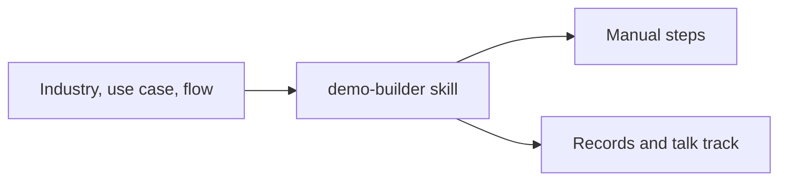

# Demo builder for Slack and Salesforce

You name an industry, a use case, and the flow. Your coding agent lists the setup that is still yours, then builds the Salesforce records and the talk track.

The manual steps are below. The skill your agent follows is [`.cursor/skills/demo-builder/SKILL.md`](.cursor/skills/demo-builder/SKILL.md). A small local app in [`app/`](app/) is the same plan, on one screen: the brief, the split between you and the agent, and a library of saved demos.



## Manual setup

Do these once for a workspace. On the next demo the agent repeats only the steps that are still open.

### 1. Connect Slack

Sign your coding agent into Slack. Write down the workspace and the channel this demo should use.

The agent drafts the swarm message and files it on the demo spec. Posting the message, installing a Slack app, and approving a workspace prompt stay in Slack admin. An agent cannot click those.

### 2. Connect a Salesforce demo org

Use a demo org, a sandbox, or a developer org where you can create accounts and cases. Keep production orgs out of this workflow.

Two ways in:

- The Salesforce connector in your agent. Sign in as a user who can create records in the demo org.
- A hosted Salesforce MCP server. In Setup, create an external client app with the OAuth callback your agent documents, add the server URL in the agent, and finish the login.

### 3. Mark the demo org and the production orgs

```bash
cp demos/org.example.json demos/org.local.json
```

Set `demoOrgLabel` to the demo org's company name, the same name Salesforce shows on the company profile. Add every production org to `productionOrgLabels`, and add hosts under `productionOrgHosts` when you know them. Put the Slack workspace and channel in `slackWorkspaceName` and `slackChannel`.

`demos/org.local.json` is gitignored. The example file has placeholders only.

### 4. Stay on objects the org already has

The agent creates and updates Accounts, Opportunities, Cases, and Slack demo bundle records. It tags each one `demo-builder:<id>` in the name and the description.

When a story needs a new object, a new field, or Apex, create that in Setup yourself, or take it out of the flow. This builder works with records on the objects a demo org already ships with.

### 5. Check a trial date

If the demo org expires, set `trialExpires` in `demos/org.local.json` to `YYYY-MM-DD`. Renew or replace the org when that date is close. Leave the field empty when the org does not expire.

## Give this to your coding agent

Open this repository in Cursor. The project skill loads from [`.cursor/skills/demo-builder/SKILL.md`](.cursor/skills/demo-builder/SKILL.md).

Start with the industry, the use case, and the beats:

```text
Follow .cursor/skills/demo-builder/SKILL.md
Industry: Healthcare
Use case: A nurse practitioner requests prior authorization for an MRI, and the payer team swarms in Slack when the case stalls.
Flow:
- Harbor & Pine Health is the member's clinic account, with Avery Cole as the patient on the chart.
- A case is filed for prior authorization of an MRI, waiting on the clinical note.
- The case stalls past the payer's two-day window.
- Slack swarms the payer channel with the case, the missing note, and the owner.
- The case moves to approved once the note arrives, and the swarm closes.
```

If your agent does not load project skills, @ that file or paste it into the chat, then send the same brief.

The agent replies with two lists before it writes anything: what you still do by hand, and what it will create. It writes only after the open manual steps are done, and only in the org named `demoOrgLabel`.

## Worked example

[demos/healthcare-prior-auth.json](demos/healthcare-prior-auth.json) is that brief, already split. Harbor & Pine Health is fictional. The file has the manual steps, the agent steps, and the talk track. Record ids, when an agent creates them, go in `demos/healthcare-prior-auth.links.json`, which is gitignored.

## Run the app

The app reads and writes the JSON specs. It does not hold Slack or Salesforce tokens.

```bash
node app/plan.test.mjs
node app/server.mjs
```

Open [http://127.0.0.1:4321](http://127.0.0.1:4321). Three views: a new brief, the split plan, and the library.

## Demo spec

Each file in `demos/` other than the org example and the gate catalog is one demo:

| Field | Meaning |
| --- | --- |
| `industry`, `useCase`, `beats` | What you asked for. Beats are the flow, in order. |
| `manualSteps` | Setup that stays with a person. The text comes from [demos/manual-gates.json](demos/manual-gates.json). |
| `agentSteps` | Records and the talk track. |
| `talkTrack` | What to show and what to say, beat by beat. |
| `tag` | The marker written onto every Salesforce record, `demo-builder:<id>`. |
| `salesforceIds` | Left empty in git. Live ids belong in `demos/<id>.links.json`. |
| `slackDraft` | The message to post, when the flow uses Slack. You send it. |

## LinkedIn

Paste this, and add the repository link:

> I built a demo builder for Slack and Salesforce. You give it an industry, a use case, and the flow. It separates the setup you still click yourself from the records and the talk track a coding agent can build. The manual steps are in the README. The skill is in the repo, so you can hand it to your own agent.

## License

[MIT](LICENSE)
