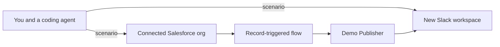

# Demo builder for Slack and Salesforce

Give a coding agent an industry, a use case, and the flow. The agent seeds the Salesforce org it is signed into, and creates a new Slack workspace for that story. Record changes show up in that workspace on their own.

You talk to the coding agent. The Slack app only publishes messages. Its manifest is [`slack/manifest.json`](slack/manifest.json). The procedure the agent follows is [`.cursor/skills/demo-builder/SKILL.md`](.cursor/skills/demo-builder/SKILL.md).



Install Demo Publisher once, on a Slack Enterprise Grid org, and grant it to workspaces created later. Each demo is a new workspace. Salesforce posts land in `#updates` in that workspace.

A Salesforce demo org is the usual place to seed. The agent uses the org it is signed into. This project does not keep a list of which orgs are allowed.

## Manual setup

Do these once. On the next demo the agent repeats only the steps that are still open.

### 1. Install the Slack app on the org

Create a Slack app from [`slack/manifest.json`](slack/manifest.json): Slack API, Create New App, From a manifest. Install it on the Enterprise Grid org, not on one workspace. Grant it to future workspaces. Approve it if the org requires an admin.

The app has no slash command and no conversation. It posts as Demo Publisher. The org-admin token from this install is what creates each new workspace.

### 2. Store the tokens

From the install, create a named credential in the Salesforce org for `https://slack.com/api`, using the bot token as a bearer token. Keep the org-admin user token in the coding agent's secret store. The agent uses that token for `admin.teams.create`. Do not commit either token.

### 3. Connect Salesforce

Sign the coding agent into the Salesforce org that should receive the records and the flow. Use the Salesforce connector, or a hosted MCP server whose external client app you create in Setup.

### 4. Let the agent deploy the publisher flow

The flow is an after-save flow on Case. When a case tagged `demo-builder:<id>` is created or its status changes, the flow POSTs [`salesforce/slack-post.json`](salesforce/slack-post.json) into `#updates` in the new workspace. The named credential supplies the bot token.

If the agent's Salesforce login can create records but cannot deploy metadata, deploy this flow once with the Salesforce CLI. Later demos reuse it and only change the workspace channel and the tag.

## Give this to your coding agent

Open this repository in Cursor. The project skill loads from [`.cursor/skills/demo-builder/SKILL.md`](.cursor/skills/demo-builder/SKILL.md).

```text
Follow .cursor/skills/demo-builder/SKILL.md
Industry: Education
Company: Northbridge Academy
Use case: An advisor picks up a student case when Maya Chen has waited two days for a course change.
Flow:
- Northbridge Academy is the school account, and Maya Chen is the student.
- A case opens for a course change, waiting on the advisor.
- The case sits past two days.
- The case moves to closed when the advisor approves the change.
```

The agent replies with the manual steps that are still open, then creates a workspace named Northbridge Academy, seeds the Salesforce records, and attaches the flow to `#updates` in that workspace. Changing the case status is what makes Demo Publisher post. You do not message the app.

[demos/education-advising.json](demos/education-advising.json) is that brief. Harbor & Pine Health in [demos/healthcare-prior-auth.json](demos/healthcare-prior-auth.json) is a second fictional story. Record ids and Slack ids, when an agent creates them, go in `demos/<id>.links.json`, which is gitignored.

Check the planner:

```bash
node scripts/plan.test.mjs
```

## What the agent will leave to you

- Installing the app on the Enterprise Grid org and granting it to future workspaces.
- Storing the bot token and the org-admin token.
- Deploying the flow when the Salesforce login cannot deploy metadata.
- Creating a new object, field, or Apex class, if the story needs one. The default path uses Account, Case, and Opportunity.

## LinkedIn

Paste this, and add the repository link:

> I built a demo builder for Slack and Salesforce. You give a coding agent an industry, a use case, and the flow. It seeds the Salesforce org and opens a new Slack workspace for that story. A small publisher app posts record changes into that workspace. The manual install steps are in the README. The skill is in the repo, so another agent can run the same build.

## License

[MIT](LICENSE)
